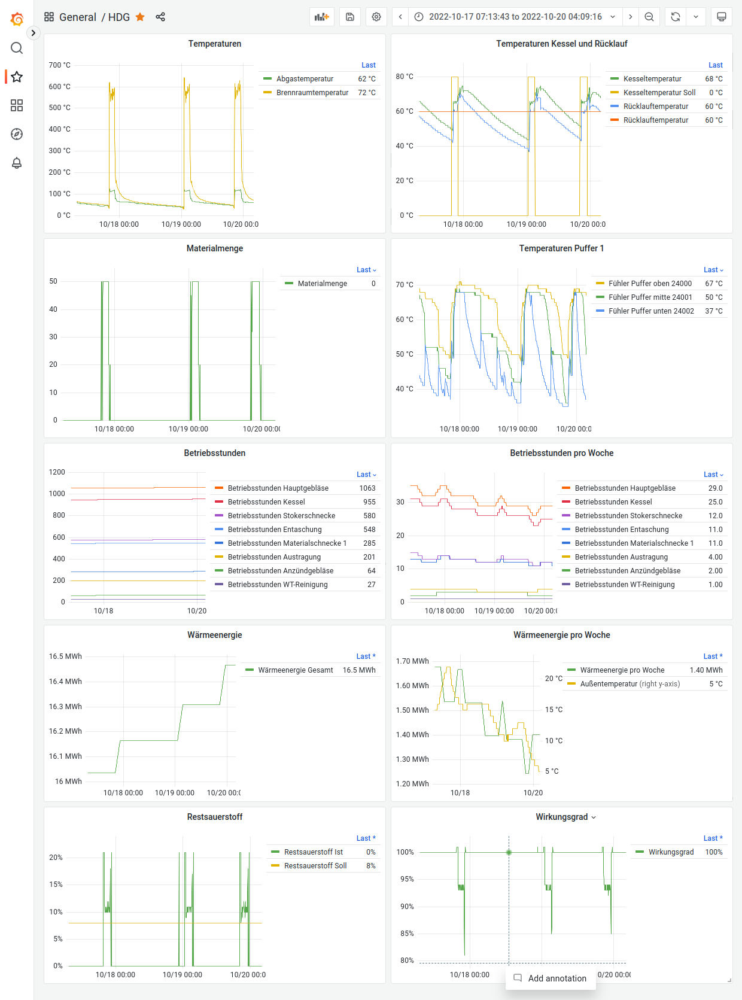

# hdg-exporter

Prometheus exporter for HDG Bavaria heating systems.

## Docker

A docker image is is available at `ghcr.io/srt/hdg-exporter`.
You can find a sample `docker-compose.yml` with Prometheus, Grafana and hdg-exporter in the `samples` subdirectory.
Just update the `HDG_ENDPOINT` environment variable.

## Configuration

HDG Exporter is configured via environment variables. The following variables are supported:

| Variable       | Description                                                                                                                                              | Example               |
| -------------- | -------------------------------------------------------------------------------------------------------------------------------------------------------- | --------------------- |
| `HDG_ENDPOINT` | URL of the heating system.                                                                                                                               | `http://192.168.1.10` |
| `HDG_LANGUAGE` | One of `dansk`, `deutsch`, `english`, `franzoesisch`, `italienisch`, `niederlaendisch`, `norwegisch`, `polnisch`, `schwedisch`, `slowenisch`, `spanisch` | `deutsch`             |
| `HDG_TIMEZONE` | Time zone of the heating system's clock, used for the logbook timestamps. Default `Europe/Berlin`.                                                       | `Europe/Berlin`       |
| `HDG_IDS`      | Comma separated list of ids to export. Can be obtained from the Web UI or from [data.json](data.json).                                                   |                       |

Formatter XML files are embedded into the exporter binary at build time. Place
the files in [formatters](formatters) using the name
`<HDG_LANGUAGE>_formatters.xml`, for example `deutsch_formatters.xml`, before
running `go build` or building the Docker image.

## Logbooks

Besides `/metrics`, the exporter serves the WebControl's logbooks as JSON. The WebControl only
renders them as HTML; the exporter fetches and parses the page on each request.

- `GET /api/messages`: the message logbook (faults `ER…` and warnings `WA…`), newest first.
- `GET /api/maintenance`: the maintenance logbook (acknowledged maintenance tasks), newest first.

```json
[{"timestamp":"2026-11-09T11:12:00+01:00","code":"ER037","kind":"fault","text":"Störung Reinigung","state":"on"}]
```

`kind` is `fault`, `warning` or `other`; `state` is `on` (coming) or `off` (going).

```json
[{"timestamp":"2026-11-16T12:02:00+01:00","task":"Aschenbehälter leeren (Störung)"}]
```

The heating system keeps only a limited number of entries, so poll and store them if you need the
full history. Texts are in the WebControl's language. The overall message status is available as
metric `hdg_value{id="20029"}` (0 = none, 1 = warning, 2 = fault).

## Grafana Dashboard



The [Dashboard](sample/grafana/provisioning/dashboards/HDG.json) can be imported into Grafana.

## Similar Projects

- [hdg-bavaria adapter for ioBroker](https://github.com/SteMaker/ioBroker.hdg-bavaria) includes a [wiki](https://github.com/SteMaker/ioBroker.hdg-bavaria/wiki) with a howto to lookup id values
